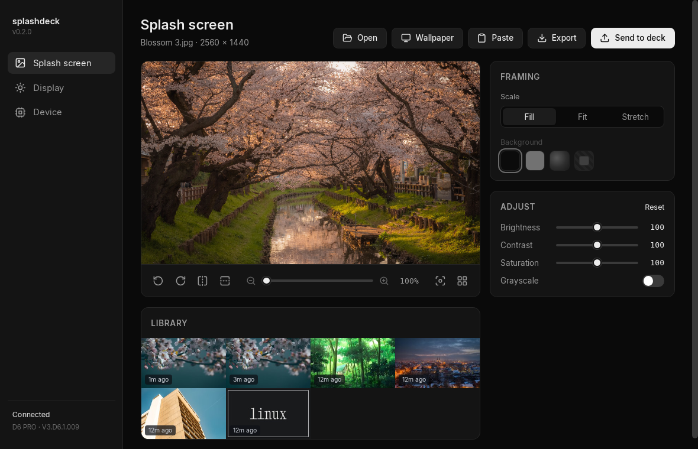

# splashdeck

Splash screen and display control for the **fifine AmpliGame D6** on Linux.

The official fifine Control Deck software is Windows-only and does not run under Wine. splashdeck talks to the device directly over USB HID, so it needs no vendor software and no kernel driver.

> **The UI was made with AI assistance.**



## Features

**Splash screen**
- Load an image from a file, drag and drop, the clipboard, or your current desktop wallpaper
- Pan, zoom, rotate and flip, with live 800 × 480 preview
- Fill, fit or stretch scaling; fit can pad with black, white, a blurred copy of the image, or a custom colour
- Brightness, contrast, saturation and grayscale adjustments
- Key overlay showing which parts of the image sit under the 15 keys
- Export the result as PNG
- Library of previously sent images for one-click reuse

**Display**
- Live brightness control
- Sleep, wake, and show the splash screen on demand

**Device**
- Model, firmware version, serial number, USB port and speed
- Permission check with the required udev rule

## Requirements

- Linux with a fifine AmpliGame D6 (USB ID `3142:0060`)
- Python 3.10+, Pillow, PyGObject, pywebview
- WebKitGTK 4.1
- A udev rule granting your user access to the device

## Installation

### Nix

```sh
nix run github:owainxyz/splashdeck
```

### NixOS

Add the flake as an input and import the module. It installs the application and the udev rule.

```nix
{
  inputs.splashdeck.url = "github:owainxyz/splashdeck";

  outputs = { nixpkgs, splashdeck, ... }: {
    nixosConfigurations.host = nixpkgs.lib.nixosSystem {
      modules = [ splashdeck.nixosModules.default ];
    };
  };
}
```

### Other distributions

Install WebKitGTK 4.1 and PyGObject from your package manager, then:

```sh
pip install --user .
sudo cp 60-splashdeck.rules /etc/udev/rules.d/
sudo udevadm control --reload
sudo udevadm trigger
```

Reconnect the device after installing the rule.

## Usage

```sh
splashdeck                                        # open the app
splashdeck image.png                              # open the app with an image loaded
splashdeck --send image.png [fill|fit|stretch]    # send without opening the app
```

Sent images are displayed immediately and every time the device powers on.

### Keyboard shortcuts

| Shortcut     | Action      |
|--------------|-------------|
| `Ctrl+O`     | Open image  |
| `Ctrl+V`     | Paste image |
| `Ctrl+E`     | Export PNG  |
| `Ctrl+Enter` | Send        |
| `R`          | Rotate      |
| `0`          | Reset view  |

### Files

| Path                                  | Contents                 |
|---------------------------------------|--------------------------|
| `~/.config/splashdeck/settings.json`  | Preferences              |
| `~/.local/share/splashdeck/history/`  | Library of sent images   |

## Protocol

splashdeck speaks the device's USB HID protocol directly. Commands are 1024-byte output reports on interface 0 prefixed with `CRT\0\0`; the splash screen is uploaded as an 800 × 480 JPEG rotated 180°.

See [docs/PROTOCOL.md](docs/PROTOCOL.md) for the full reference.

Tested on a D6 PRO running firmware `V3.D6.1.009`.

## Documentation

- [Protocol reference](docs/PROTOCOL.md)
- [Troubleshooting](docs/TROUBLESHOOTING.md)
- [Changelog](CHANGELOG.md)

## Contributing

Contributions are welcome. Read [CONTRIBUTING.md](CONTRIBUTING.md) before opening a pull request, and see [AGENTS.md](AGENTS.md) if you use a coding agent. Security issues should be reported as described in [SECURITY.md](SECURITY.md).

This project follows a [Code of Conduct](CODE_OF_CONDUCT.md).

## License

[MIT](LICENSE)
